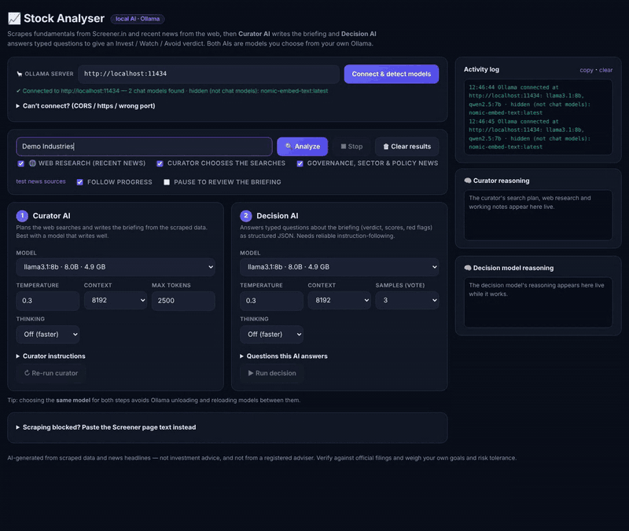
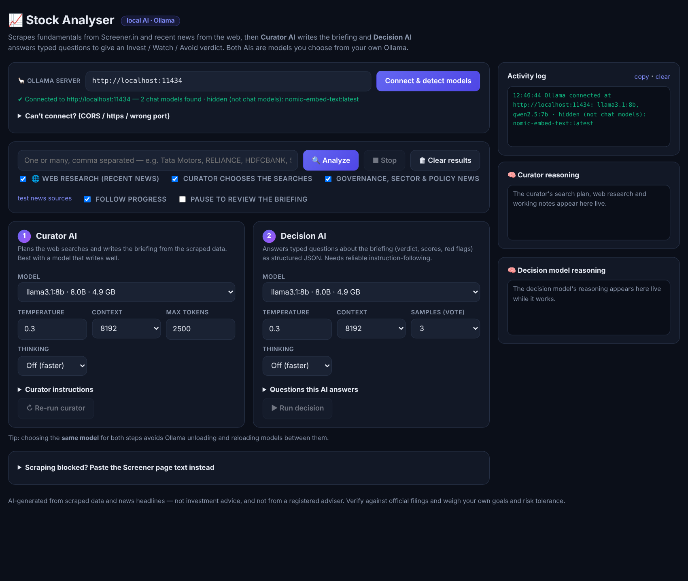
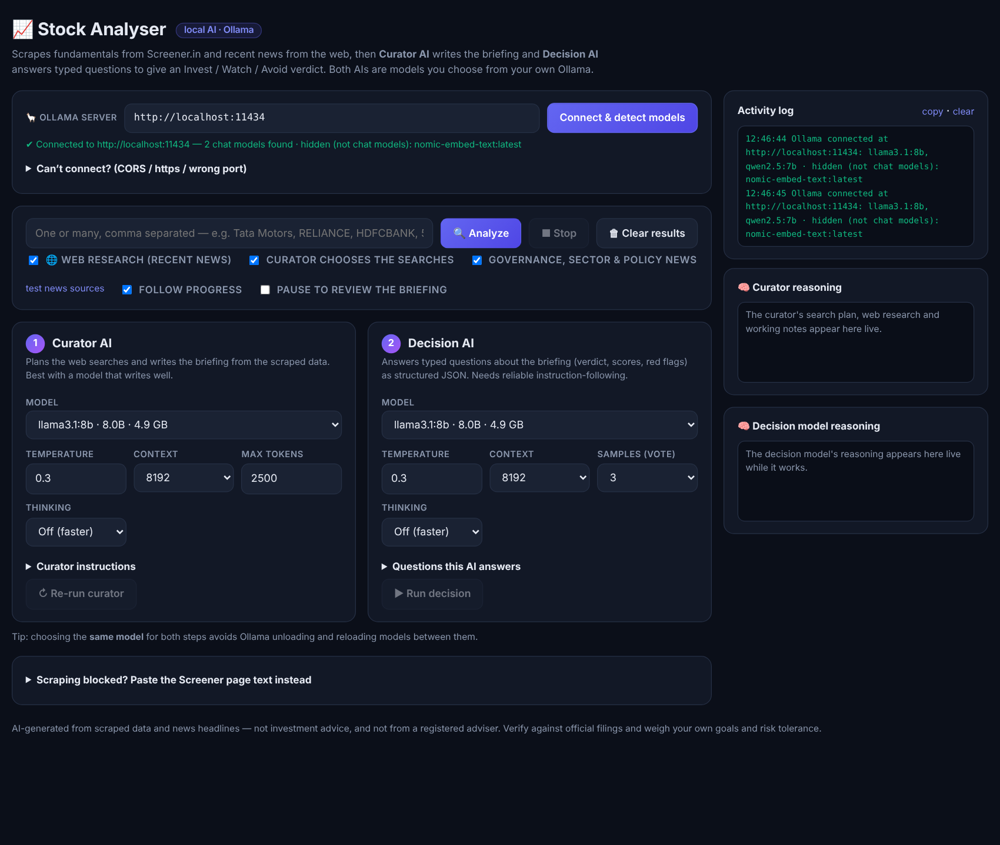
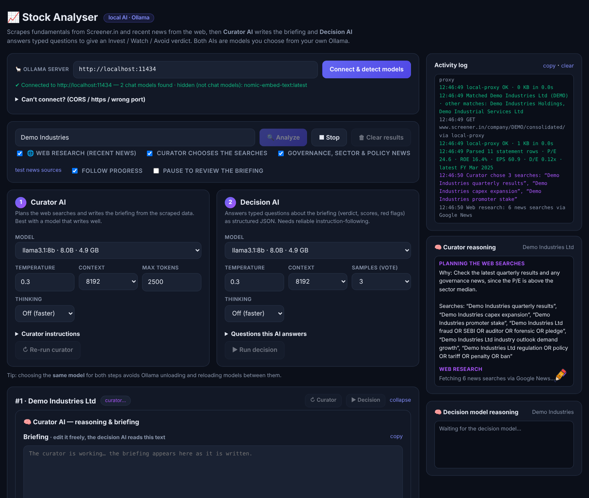
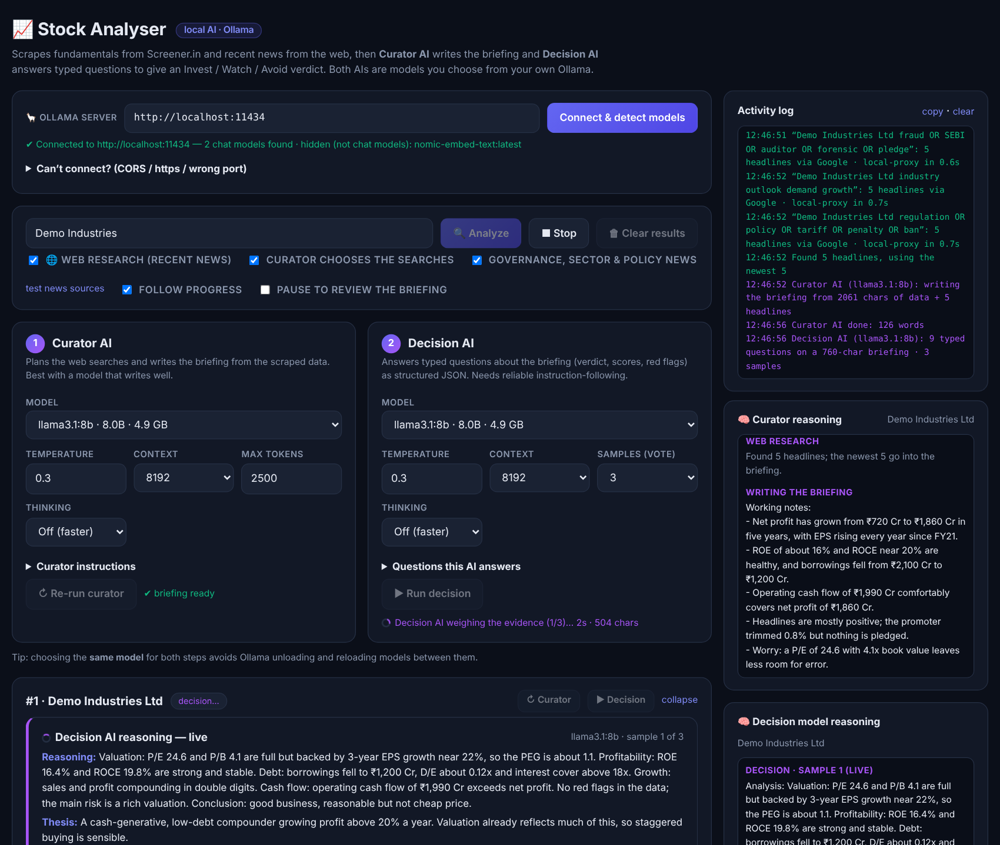
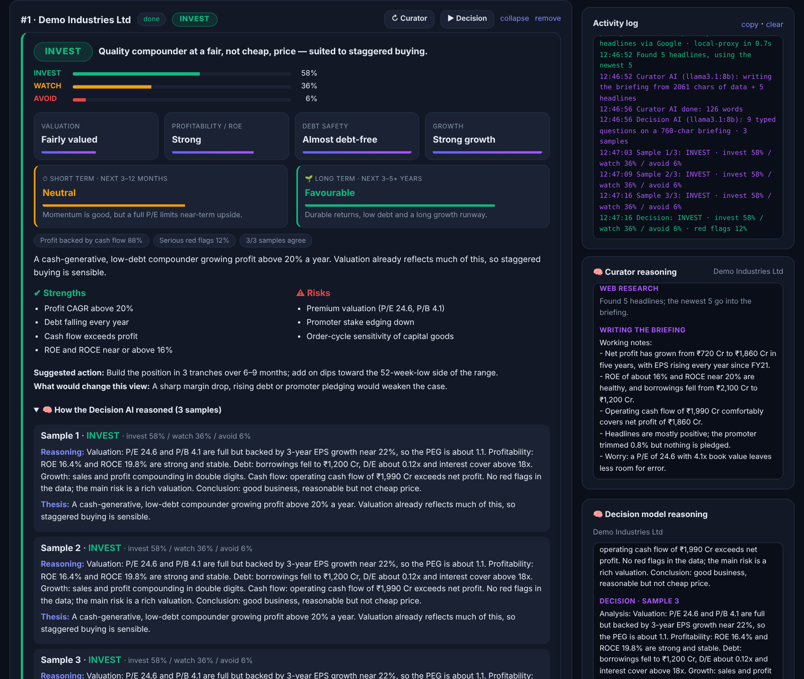

# 📈 Stock Analyser · Local AI

A single-file web app that analyses Indian listed stocks **entirely with models running on your own machine**. It scrapes fundamentals from [Screener.in](https://www.screener.in) and recent headlines from Google/Bing News, then two local [Ollama](https://ollama.com) models do the thinking:

1. **Curator AI** plans the news searches and writes a briefing from the scraped numbers and headlines.
2. **Decision AI** answers a fixed set of typed questions about that briefing (valuation, profitability, debt, growth, cash backing, red flags, short- and long-term outlook) and gives an **INVEST / WATCH / AVOID** verdict with probabilities.

You can watch both models reason live, and a little cartoon pen "writes" their reasoning as it streams in. No API keys, no cloud LLM, no build step.



> The recording and screenshots in this README use a **fictional company ("Demo Industries Ltd") with simulated data and simulated model replies**, so they show the interface and workflow only — not a real analysis.
> A full-quality video is in [`docs/demo.mp4`](docs/demo.mp4).

---

## Contents
- [Features](#features)
- [Requirements](#requirements)
- [Quick start](#quick-start)
- [How to use it (step by step)](#how-to-use-it-step-by-step)
- [Settings explained](#settings-explained)
- [Troubleshooting](#troubleshooting)
- [How it works](#how-it-works)
- [Disclaimer](#disclaimer)

## Features
- 🦙 **Runs on your own models** – pick any chat model installed in Ollama for each step (embedding-only models are filtered out automatically).
- 🔎 **Live data** – fundamentals (multi-year P&L, balance sheet, cash flow and key ratios) from Screener.in; news via Google News, Bing News and GDELT routes that race in parallel.
- 🧠 **Visible reasoning** – streaming panels for the curator's search plan and notes and for the decision model's analysis, with thinking traces for reasoning models.
- ✒️ **Animated pen** – a cartoon pen follows the end of the streamed text as if writing it.
- 🗳️ **Voting** – run the decision model 1, 3 or 5 times and average the probabilities for steadier answers from small models.
- 📚 **Batch mode** – enter several stocks separated by commas; they run one after another.
- ⏸️ **Review mode** – pause after the curator to read or edit the briefing before the decision model sees it.
- ■ **Stop button** – cancels scraping, news fetching and model calls immediately.
- 📋 **Paste fallback** – if scraping is blocked, paste the Screener page text instead.
- 🧾 **Activity log** – every request and model step is logged; one click to copy it for debugging.

## Requirements
| What | Why |
|---|---|
| A modern browser (Chrome, Edge, Firefox, Safari) | The whole app is one HTML file |
| [Ollama](https://ollama.com) with at least one chat model | e.g. `ollama pull qwen2.5:7b` or `ollama pull llama3.1:8b` |
| Internet access | To reach Screener.in and news sources |

Using the **same model for both steps** is recommended on modest hardware — Ollama then doesn't have to unload and reload models between steps.

## Quick start

```bash
# 1. get the code
git clone https://github.com/<your-username>/stock-analyser.git
cd stock-analyser

# 2. install a model (any chat model works)
ollama pull qwen2.5:7b

# 3. serve the page from localhost (avoids Ollama's CORS block — see below)
python -m http.server 8000
```

Then open **http://localhost:8000/stock_analyser.html**.

> **Why serve it?** Browsers send the origin `null` for pages opened straight from disk, and Ollama rejects that by default. Pages served from `localhost` are allowed out of the box.
> Prefer double-clicking the file? Allow all origins once and fully restart Ollama:
> ```bash
> # Windows (PowerShell)   setx OLLAMA_ORIGINS "*"
> # macOS                  launchctl setenv OLLAMA_ORIGINS "*"
> # Linux (systemd)        sudo systemctl edit ollama   # add: Environment="OLLAMA_ORIGINS=*"
> #                        sudo systemctl restart ollama
> ```

## How to use it (step by step)

### 1 · Connect to Ollama
Leave the server address as `http://localhost:11434` (change it if Ollama runs elsewhere) and click **Connect & detect models**. The app lists every chat-capable model it finds and fills both model drop-downs.





### 2 · Choose your models
- **Curator AI** – should write well (e.g. `llama3.1:8b`, `qwen2.5:14b`).
- **Decision AI** – needs to follow instructions and return valid JSON.
- Turn **Thinking** on only for reasoning models (e.g. DeepSeek-R1-style, Qwen3).
- Use **Samples (vote)** of 3 or 5 for steadier verdicts from small models.

### 3 · Enter one or more stocks and click **Analyze**
Type a company name, an NSE symbol or a BSE code — or a Screener URL. Separate several with commas:

```
Tata Motors, RELIANCE, HDFCBANK, 500325
```

Optional switches under the search box:

| Option | Effect |
|---|---|
| Web research (recent news) | Fetch headlines for the briefing |
| Curator chooses the searches | The model picks up to 3 news searches (off = fixed searches) |
| Governance, sector & policy news | Adds searches for fraud/auditor/pledge, sector outlook and regulation |
| Follow progress | Scroll to each stock as its analysis starts |
| Pause to review the briefing | Stop after the curator so you can edit the briefing first |

### 4 · Watch the curator work
The curator plans its searches, the page fetches headlines, then the briefing is written. The pen in the **Curator reasoning** panel follows the text as it streams.



### 5 · Watch the decision model reason
The decision model works through the questions step by step, once per sample. Its analysis, thesis, strengths, risks, scores and probabilities appear live.



### 6 · Read the verdict
You get an **INVEST / WATCH / AVOID** call with probabilities, scores for valuation, profitability, debt safety and growth, short- and long-term outlooks, cash-flow backing, red-flag likelihood, strengths and risks, a suggested action, what would change the view, and the full reasoning for every sample.



### Re-running pieces
Each stock card has **↻ Curator** and **▶ Decision** buttons, so you can redo just one step — for example, edit the briefing, then run only the decision again.

### Stopping a run
Press **■ Stop** at any time. It cancels in-flight scraping, news requests and model generation; a batch stops and the remaining stocks are marked cancelled.

### If scraping is blocked
Open the company page on screener.in, select all (Ctrl/Cmd + A), copy, then paste into **“Scraping blocked? Paste the Screener page text instead”** at the bottom and click **Analyze pasted text**.

## Settings explained

| Setting | Meaning |
|---|---|
| Temperature | Randomness. 0.2–0.4 is a good range for analysis |
| Context | Tokens the model can read. 8192 is fine for most briefings; raise it if output is cut off |
| Max tokens | Upper limit on the curator's reply |
| Thinking | Ask reasoning-capable models to think first (slower, often better) |
| Samples (vote) | How many times the decision model answers; probabilities are averaged |

Your settings are remembered in the browser's local storage.

## Troubleshooting

| Symptom | Fix |
|---|---|
| “Nothing reachable at http://localhost:11434” | Is Ollama running? Open `http://127.0.0.1:11434` in the browser – it should say *Ollama is running*. |
| “Ollama IS running … but the browser blocked the reply (CORS)” | Serve the page with `python -m http.server`, or set `OLLAMA_ORIGINS="*"` and fully restart Ollama (see Quick start). |
| Page opened over `https://` can't reach local Ollama | Browsers block `https` pages from calling `http://localhost`. Open the file locally or serve it over plain `http://localhost`. |
| Model list is empty | Pull a chat model: `ollama pull qwen2.5:7b`. Embedding-only models are hidden on purpose. |
| Scraping fails / “BLOCKED” | Use the paste fallback above, or try again later – public proxies are rate limited. |
| News sources all fail | Click **test news sources** to see which routes work from your network. |
| Decision AI returns invalid JSON | Use a larger or more instruction-following model, turn **Thinking** on for reasoning models, or raise **Context**. |
| Briefing looks cut off | Raise **Max tokens** or **Context**. |

### Optional local scraper proxy
The app first looks for a helper at `http://localhost:8787` (`/health` returning `ok`, and `/proxy?url=…` returning the fetched page) and uses it when present; otherwise it falls back to public CORS proxies. A helper script is **not included in this repository**, so the public proxies are used by default.

## How it works

```
Screener.in ──► fundamentals ─┐
                              ├─► Curator AI ─► briefing ─► Decision AI ─► verdict + scores
Google/Bing/GDELT ─► news ────┘   (Ollama)                  (Ollama, N votes)
```

- Everything runs in the browser; the only servers contacted are Ollama (yours), Screener.in and the news/proxy endpoints.
- The decision model is asked for JSON that follows a fixed schema; replies are validated, normalised and averaged across samples.
- Nothing is sent to any LLM provider other than the Ollama address you configure.

## Disclaimer
This tool produces AI-generated analysis from scraped data and news headlines. It is **not investment advice**, and it is not from a registered adviser. Small local models make mistakes and scraped data can be incomplete or wrong. Verify against official filings and consider your own goals and risk tolerance before investing.
